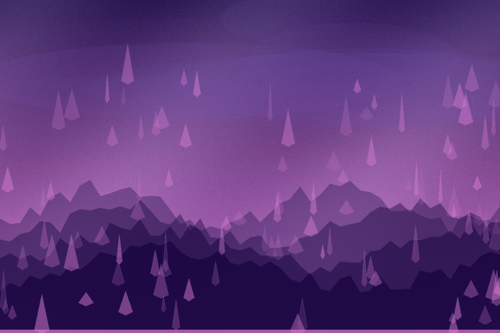
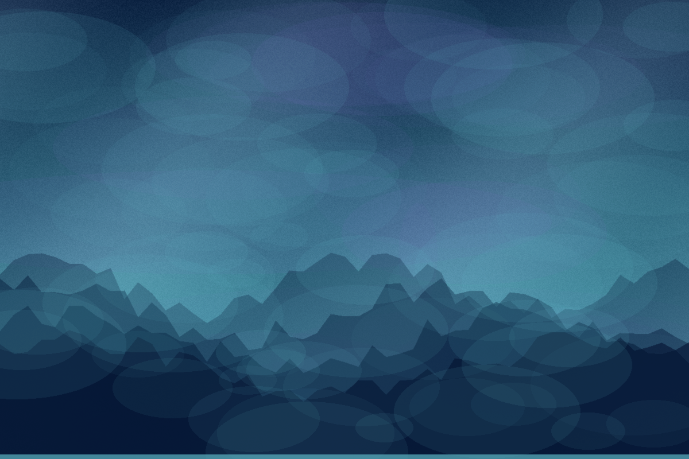
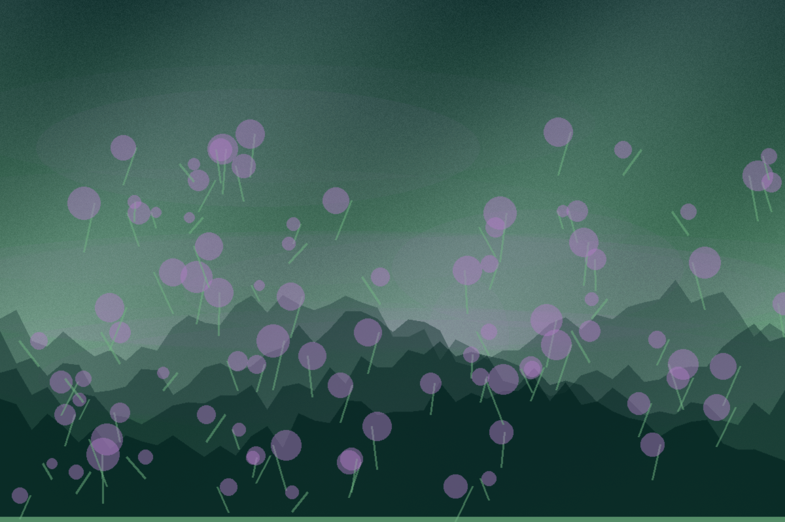
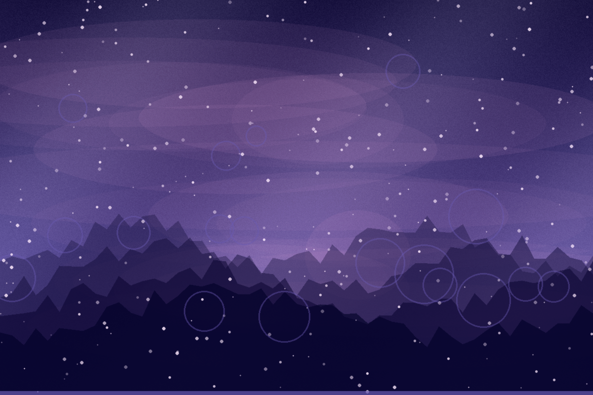
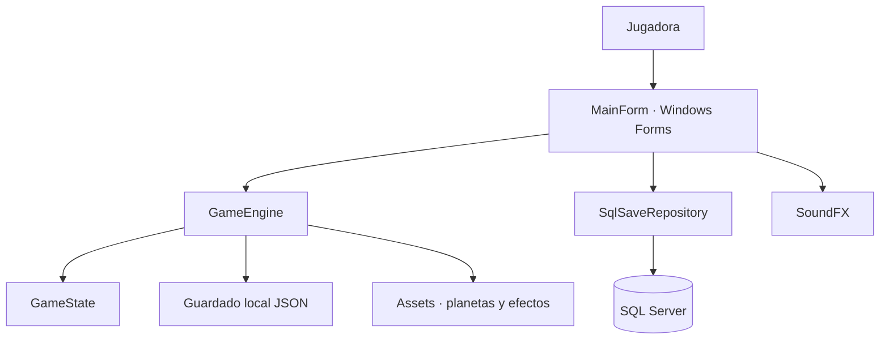

# ✦ NEXUS — Expedición Eos

<p align="center">
  
</p>

<p align="center">
  <strong>CUATRO MUNDOS · CUATRO EXPEDICIONES · UNA MISIÓN</strong><br>
  Videojuego de acción y exploración 2D desarrollado en C#, Windows Forms y .NET 8.
</p>

<p align="center">
  
  
  
  
</p>

NEXUS es una aventura espacial en la que una exploradora debe recorrer cuatro planetas, cumplir objetivos, reunir recursos y mejorar su equipo. El repositorio conserva el proyecto original de consola H3 y la evolución gráfica actual.

---

## 🌌 Explora los cuatro sectores

Las texturas que aparecen a continuación son los recursos gráficos incluidos en el juego. El orden corresponde a las cuatro misiones definidas en `GameEngine`.

<table>
  <tr>
    <td align="center" width="25%">
      <br>
      <strong>01 · EOS</strong><br>
      <sub>Jardín de Cristal</sub><br>
      <sub>Reúne 3 Fragmentos Prismáticos.</sub>
    </td>
    <td align="center" width="25%">
      <br>
      <strong>02 · NÉBULA</strong><br>
      <sub>Archivo Sumergido</sub><br>
      <sub>Recupera 4 Núcleos de Datos.</sub>
    </td>
    <td align="center" width="25%">
      <br>
      <strong>03 · SYLVARA</strong><br>
      <sub>Santuario de las Lunas</sub><br>
      <sub>Sincroniza 3 Altares Lunares y supera al Acechador.</sub>
    </td>
    <td align="center" width="25%">
      <br>
      <strong>04 · ASTRALIS</strong><br>
      <sub>Corazón del Vacío</sub><br>
      <sub>Desactiva 2 pilares y vence al Coloso.</sub>
    </td>
  </tr>
</table>

## ✨ ¿Qué puedes hacer en NEXUS?

- Explorar escenarios 2D con cámara, obstáculos, radar y objetivos.
- Completar cuatro expediciones con desafíos diferentes.
- Moverte, apuntar, usar habilidades e interactuar con el entorno.
- Recoger recursos y consultar los indicadores de la exploradora.
- Mejorar el cañón, el blindaje, los propulsores y el dron en la Armería.
- Guardar el progreso localmente en JSON o utilizar la persistencia SQL Server.

## 🎮 Controles

| Tecla / entrada | Acción |
|---|---|
| **W, A, S, D** o flechas | Movimiento |
| **Ratón** | Apuntar |
| **Clic izquierdo** o **Espacio** | Disparo dentro del juego |
| **Shift** o **clic derecho** | Impulso |
| **Q** | Onda prismática |
| **E** | Interactuar / activar portal |
| **H** | Usar botiquín |
| **U** o **B** | Abrir Armería |
| **M** | Activar o silenciar sonido |
| **F5** | Guardar partida local |
| **Esc** | Pausa |

## 🧩 Cómo está construido

| Componente | Responsabilidad |
|---|---|
| `MainForm.cs` | Ventanas, controles, eventos, HUD y navegación |
| `GameEngine.cs` | Reglas, movimiento, misiones, encuentros y progresión |
| `GameState` | Estado que se conserva entre guardados |
| `SqlSaveRepository.cs` | Conexión y operaciones de persistencia SQL |
| `SoundFX.cs` | Reproducción y control de audio |
| `Assets/Planets` | Texturas de los cuatro planetas |
| `Assets/Audio` | Pistas de audio de las expediciones |
| `Assets/UI` | Recursos gráficos de interfaz |

### Arquitectura en una mirada



## 🚀 Ejecutar el proyecto

### Requisitos

- Windows 10 u 11.
- .NET 8 SDK.
- Visual Studio 2022 con la carga de trabajo **Desarrollo de escritorio de .NET**.
- SQL Server o SQL Server Express y SSMS, únicamente si se desea probar la persistencia SQL.

### Pasos

1. Clona o descarga el repositorio.
2. Abre `NEXUS.sln` en Visual Studio.
3. Selecciona `NEXUS` como proyecto de inicio.
4. Ejecuta con **F5**.

También se incluye `COMPILAR_Y_EJECUTAR.bat` para compilar desde Windows con el SDK instalado.

## 💾 Guardado y base de datos

NEXUS tiene dos mecanismos de persistencia independientes:

**Guardado local JSON**
- Se almacena en la carpeta de datos locales del usuario, dentro de `NEXUS/expedicion.json`.
- Se puede guardar con F5 o desde la pausa.
- El juego también realiza autoguardado periódico.

**SQL Server**
1. Abre `NEXUS/SQL/CrearBaseNEXUS.sql` en SQL Server Management Studio.
2. Ejecuta el script.
3. Si tu instancia es distinta de la configuración predeterminada, configura la variable de entorno `NEXUS_SQL_CONNECTION`.
4. Inicia el juego y utiliza las opciones de Archivo / Base de Datos SQL.

El script crea cinco tablas: `Perfiles`, `Misiones`, `Partidas`, `ProgresoMisiones` y `MejorasPartida`. El inventario se serializa en el campo `InventarioJson` de `Partidas`; no existe una tabla independiente de inventario en el esquema actual.

> **Nota:** el guardado local JSON no demuestra por sí solo que la conexión SQL funcione. Para verificar SQL se debe ejecutar el script y probar las opciones SQL contra una instancia configurada.

## 📚 Documentación del proyecto

| Documento | Contenido |
|---|---|
| [Diseño del juego](Docs/diseno-del-juego.md) | Visión, ciclo de juego, reglas y expediciones |
| [Arquitectura actual](Docs/arquitectura-actual.md) | Clases y funcionamiento del código actual |
| [Arquitectura propuesta](Docs/arquitectura-propuesta.md) | Organización de interfaz, lógica y datos |
| [Modelo de datos](Docs/modelo-de-datos-propuesto.md) | Tablas y persistencia SQL |
| [Análisis técnico](Docs/analisis-tecnico.md) | Alternativas y decisiones tecnológicas |
| [Identidad visual](Docs/identidad-visual.md) | Paleta, recursos y estilo de NEXUS |
| [Manual técnico H3](Docs/Manual_Tecnico_NEXUS_H3.md) | Referencia del proyecto original |
| [Bocetos de pantallas](Docs/evidencias/bocetos-pantallas.md) | Esquemas de interfaz |
| [Diagramas](Docs/evidencias/diagramas.md) | Arquitectura y procesos |
| [Guía de evidencias](Docs/evidencias/README.md) | Capturas reales que faltan adjuntar |

## 🛠️ Validación automática

El repositorio incluye GitHub Actions en `.github/workflows/validar-nexus.yml` para restaurar y compilar la solución en un entorno Windows con .NET 8. La compilación automática no sustituye las pruebas manuales del juego ni la comprobación de SQL Server.

## 📁 Estructura principal

```text
NEXUS-COMP/
├── .github/workflows/
├── ConsoleApp1/                 # Proyecto original H3
├── NEXUS/
│   ├── Assets/
│   │   ├── Audio/
│   │   ├── Planets/
│   │   └── UI/
│   ├── SQL/
│   ├── GameEngine.cs
│   ├── MainForm.cs
│   ├── SqlSaveRepository.cs
│   └── SoundFX.cs
├── Docs/
│   ├── evidencias/
│   └── ...
├── NEXUS.sln
└── README.md
```

## 📌 Estado del proyecto

La versión gráfica y las cuatro expediciones están presentes en el código. El proyecto incluye guardado local y operaciones de persistencia SQL; la conexión SQL depende de la configuración de cada equipo.

Las capturas de funcionamiento y las pruebas de guardado/carga deben obtenerse ejecutando el juego y SQL Server en el equipo correspondiente. Los bocetos son material de diseño y no sustituyen esas evidencias.
